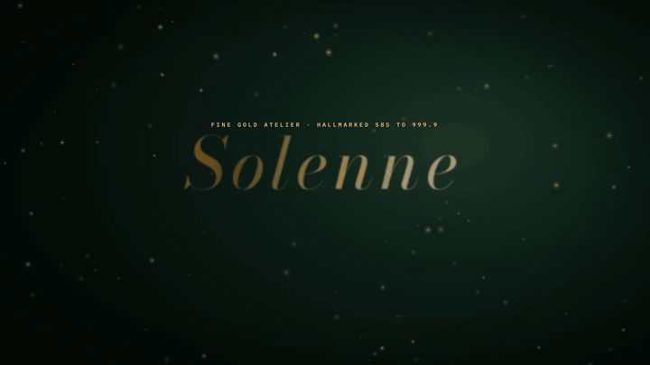
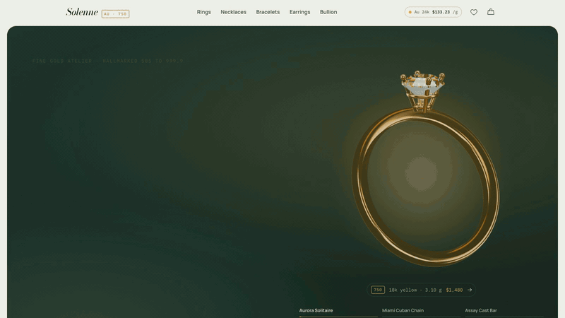
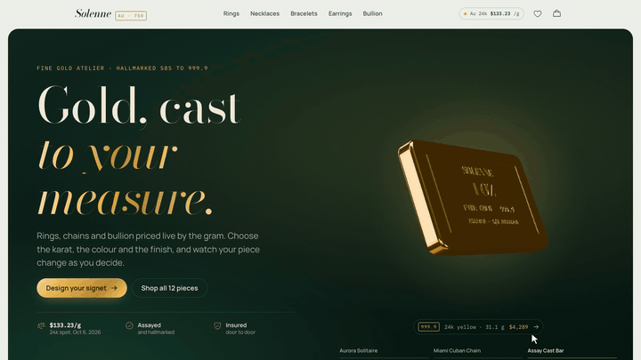
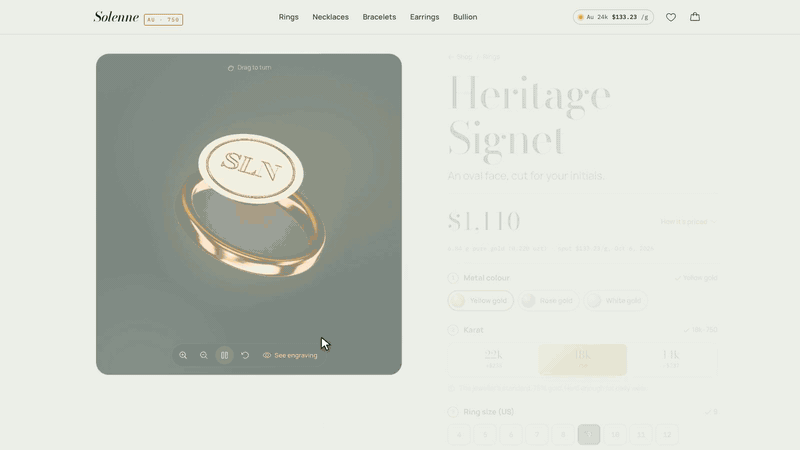
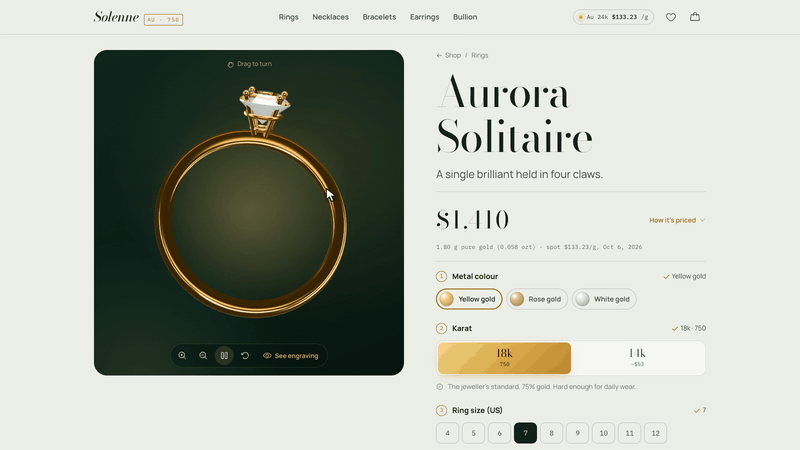
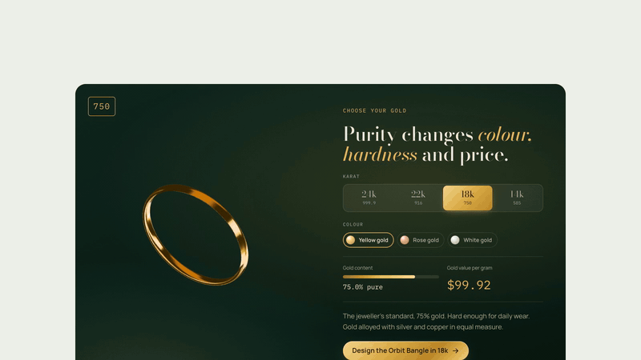
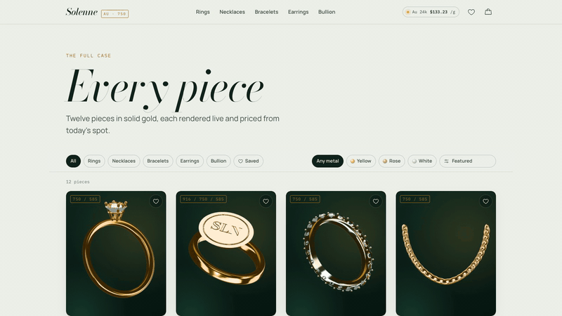
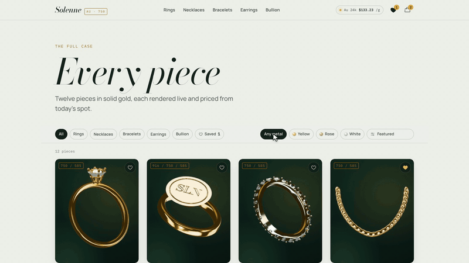
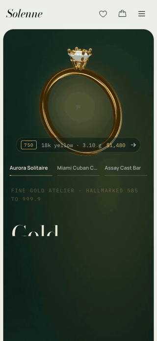
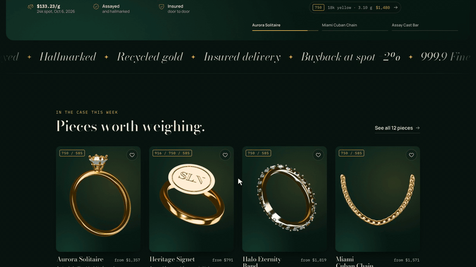

<div align="center">

# Solenne

### A gold-jewellery storefront where every piece is rendered live in 3D and priced to the gram

[](docs/media/teaser.mp4)

**▶ [Watch the full teaser with sound (MP4, 60 s)](docs/media/teaser.mp4)**


</div>

---

Solenne is a complete online shop for fine gold: rings, chains, bracelets, earrings and bullion. It contains **no photographs**. Every ring, chain, coin and bar is built from code and rendered in the visitor's browser with three.js. When a customer picks rose gold, 22 karat or a hammered finish, they see the change on the piece and in the price straight away.

The whole storefront, including the 3D engine, ships as **one self-contained HTML file** (about 1.3 MB, or 380 KB gzipped). There is no server to run. It is published as a claude.ai Artifact, which stores orders in its own database, and it also runs on any static host.

> **What the GIFs below show:** every clip was recorded from the running app in Chrome, with no mock-ups and no editing. A gold cursor marks each click.

## Why customers will love it

| | |
|---|---|
| ✨ **See the real piece** | Twelve products, each a procedural 3D model with polished, satin-brushed or hand-hammered metal, brilliant-cut diamonds that refract light, and engraving you can read. Drag to turn, zoom, or let it sway. |
| ⚖️ **Honest, live pricing** | Prices follow the 24k gold spot price: grams × purity × spot, plus labour and stones. "How it's priced" opens the full calculation. |
| 💍 **Made to measure** | Customers choose colour, karat (24k · 22k · 18k · 14k), ring size or chain length, band width, finish and engraving. Each choice shows its effect on the price before they click it. |
| ✍️ **Engraving preview** | The inscription appears on the 3D model as it is typed. "See engraving" turns the camera to look inside the band. |
| 🛍️ **Smooth checkout** | A bag drawer with a free-shipping meter, a one-page checkout with friendly validation, insured or express delivery, and no card needed up front. |
| 📱 **Works on any screen** | Responsive down to 375 px, light and dark themes, and reduced motion respected. |
| 🔒 **Nothing to host** | A single HTML file. Orders go to the Artifact database, with a copyable order summary as a fallback. |

---

## A tour of the app

### 1. Live 3D hero
The headline rises into place while a solitaire turns slowly in a velvet jewel box. Moving the pointer adds parallax, and the tabs cross-fade to the Miami Cuban chain and the 1 oz cast bar. The plate under each piece shows its karat, weight and live price.



### 2. Home page scroll
A marquee that reacts to scroll speed, a "Pieces worth weighing" grid, and a pinned horizontal rail through the five collections. Scrolling is smoothed with Lenis and GSAP ScrollTrigger.



### 3. The configurator
On the Heritage Signet: yellow → rose → white gold, then 22k → 14k → 18k, with the price rolling to each new total. The finish moves through hand hammered, satin brushed and high polish, then a monogram is cut into the face and the ring is turned by hand.



### 4. Engraving, previewed as you type
"Always, M & J" is engraved inside the Aurora Solitaire's band as it is typed. **See engraving** swings the camera inside the ring to read it.



### 5. Karat explorer
Purity changes colour, hardness and price. Each karat shows its fineness hallmark (999.9 / 916 / 750 / 585), its gold content and its value per gram at today's spot. 24k is offered in yellow only, as in real metallurgy.



### 6. The catalogue
Cards tilt toward the pointer, with a light sweep following it. The page shows Quick add with the fly-to-bag animation, saving to the wishlist, and filtering by collection and by metal colour.



### 7. Bag, checkout and confirmation
The bag drawer opens with a free insured shipping meter, then the quantity changes. Checkout validates as you type, offers insured or express delivery, and ends on a confirmation page with an order code and a copyable summary.



### 8. Mobile and dark mode

<table>
<tr>
<td width="34%"></td>
<td>
<b>On a phone</b>, the hero, menu, Rings collection, Halo Eternity Band and a colour change are followed by the sticky "Add to bag" bar and the bag drawer.<br><br>
<b>In dark mode</b> (below), the site follows the visitor's system theme. The velvet jewel box looks the same in both themes, as a jeweller's tray would.
</td>
</tr>
</table>



---

## The collection

| Collection | Pieces |
|---|---|
| **Rings** | Aurora Solitaire · Heritage Signet · Halo Eternity Band |
| **Necklaces** | Miami Cuban Chain · Twist Rope Chain · Liquid Herringbone · Sol Coin Pendant |
| **Bracelets** | Orbit Bangle · Riviera Tennis Bracelet |
| **Earrings** | Luna Hoops |
| **Bullion** | Assay Cast Bar · Meridian Round |

### How a price is calculated

```
grams      = variant grams × size factor        (ring +3% per US size; chains by length)
pure grams = grams × purity                     (24k .9999 · 22k .916 · 18k .750 · 14k .585)
metal      = pure grams × spot (USD per gram of 24k)
making     = labour % or flat fee (jewellery) | premium (bullion)
total      = metal + making + stones + engraving ($35)
```

The spot price defaults to $133.23/g. The shop owner can change it live through one database document, `config/spot`, and every open page reprices immediately. Insured shipping is free from $500, otherwise $25. Express costs $45.

---

## Deploy it

The build produces a single HTML file, so deployment comes down to putting that file somewhere.

```bash
npm install
npm run build        # typecheck → single-file Vite build → dist/index.html + dist/artifact.html
```

### Option A: claude.ai Artifact (the recommended path, with an order database)

This is how the live shop runs. The Artifact host provides hosting, a private database for orders and the spot price, and the viewer's identity, so you need no backend.

1. Run `npm run build`. It prints `artifactize: dist/artifact.html (… KB)`. `scripts/artifactize.mjs` strips the `<html>/<head>/<body>` skeleton because the host adds its own, and keeps `<title>` within the first 8 KB.
2. In [Claude Code](https://claude.com/claude-code), ask Claude to publish `dist/artifact.html` as an Artifact with these capabilities:
   ```json
   {
     "db": { "rules": [
       { "path": "", "read": "view", "write": "owner" },
       { "path": "orders", "read": "owner", "write": "owner" },
       { "path": "orders/{self}", "write": "interact" }
     ]},
     "user": {}
   }
   ```
3. Optionally seed the spot price with the document `config/spot` set to `{ "perGram": 133.23, "asOf": "2026-10-06" }`.
4. To share the shop, open the Artifact on claude.ai, choose **Share** and turn on the link. Signed-in contributors' orders are saved to the database. You, as owner, can read them all at `#ledger`. Visitors who cannot write still get an order code and a copy-ready summary to email.
5. To update the shop later, publish to the **same URL** so the link and the database survive.

### Option B: any static host (Netlify, Vercel, GitHub Pages, S3, nginx…)

`dist/index.html` is a normal, complete web page. Upload it as `index.html`:

```bash
# Netlify
npx netlify deploy --dir dist --prod
# Vercel
npx vercel deploy dist --prod
# Anything else: copy dist/index.html to your web root
```

All routes are hash-based (`#shop`, `#p-<slug>`, `#checkout`…), so you need no rewrite rules. Without the Artifact runtime there is no database. Browsing, configuring, the bag and checkout still work, and the confirmation page provides the copyable order summary.

### Run it locally

```bash
npm run dev          # http://localhost:5173
npm run preview      # serves the production build on http://localhost:4173
```

---

## Under the hood

| Layer | What it does |
|---|---|
| `src/domain` | Catalogue, pricing and formatting. Pure TypeScript with no React or DOM. |
| `src/three` | One shared `WebGLRenderer`, a baked light-box environment, alloy materials per karat and colour, canvas-drawn normal maps (hammered, brushed, herringbone, coin reeding), engraving textures, and 12 procedural model factories. |
| `src/state`, `src/services` | Small observable stores for the bag, wishlist and spot price. Wrappers for the Artifact database and user. Throw-safe localStorage. |
| `src/components`, `src/pages` | React 19 UI with `motion` transitions, GSAP + Lenis for scroll scenes, and Phosphor icons. |

**Stack:** React 19 · TypeScript (strict) · Vite 8 + `vite-plugin-singlefile` · three.js 0.186 · motion · GSAP ScrollTrigger · Lenis · Phosphor Icons · Bodoni Moda / Manrope / IBM Plex Mono.

**Performance notes:** one GL context feeds every view, and each view is copied into its own 2D canvas. The render loop runs only while a live view is on screen. Catalogue images are rendered once, during idle time, into cached WebP blobs.

More detail is in the docs:
[architecture](docs/architecture.md) · [3D rendering](docs/3d-rendering.md) · [design system](docs/design-system.md) · [data model](docs/data-model.md) · [deployment](docs/deployment.md) · [decision records](docs/adr/README.md) · [changelog](docs/CHANGELOG.md)

---

<div align="center">

**Solenne** · *Gold, cast to your measure.*

<sub>The teaser and GIFs were recorded from this repository's own build. The soundtrack is an original composition, synthesized for this project.</sub>

</div>
