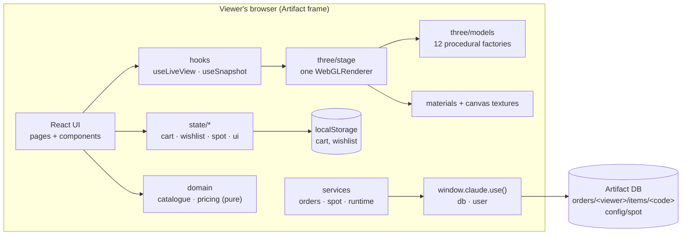

# Architecture

Solenne is a client-only single-page storefront. It is built with Vite into **one self-contained HTML file** and
published as a **claude.ai Artifact**. The Artifact host provides hosting, a per-artifact database (orders, spot
price) and viewer identity; there is no other backend.

## Layers and rules
| Layer | May import | Must not |
|---|---|---|
| `domain` | nothing app-specific | React, DOM, three |
| `three` | `domain` types | React, stores |
| `state`, `services` | `domain` | components |
| `hooks` | `three`, `state`, `domain` | pages |
| `components`, `pages` | everything above | create renderers, call `window.claude` directly |

## Request flow: configuring a piece
1. `ProductPage` holds a `Config` (colour, karat, variant, size, finish, engraving) in local state.
2. `Configurator` emits patches; `price(product, config, spot)` recomputes synchronously (pure).
3. `Viewer` → `useLiveView` → `LiveView.set()` → `ProductScene.set()`:
   geometry rebuilds only when `geometryKey` changes (model/variant, plus karat for rounds);
   colour/karat/finish swap a cached material; engraving redraws one canvas texture.
4. "Add to bag" stores the `CartLine` (slug + config) in `cartStore` (persisted to localStorage).

## Rendering pipeline (details in `3d-rendering.md`)
One `Stage` owns the only GL context. Each visible `LiveView` renders into the shared GL canvas and copies the
pixels into its own 2D canvas; card images are rendered once into blob URLs by `snapshots.ts`.

## Routing
Hash-only, one bare token per route because the host forwards only `#token` hashes (see `src/router.ts`).
Pages are swapped inside `AnimatePresence mode="wait"`; scroll resets after the exit animation.

## Persistence
| Data | Where | Why |
|---|---|---|
| Cart, wishlist, last checkout details | localStorage (`solenne.*`) | per-viewer convenience; may be unavailable |
| Orders | Artifact DB `orders/<viewer id>/items/<code>` | the shop owner must read them |
| Spot price | Artifact DB `config/spot` | owner updates price without republishing |

## Constraints that shaped this design
See `CLAUDE.md` → "Hard constraints". Key consequences: no product photos (CSP) → procedural 3D;
no server → orders in the Artifact DB with a copy-to-email fallback; single file → `vite-plugin-singlefile`.

## Decision log
- [ADR-0001](adr/0001-stack.md) Stack: React + Vite + motion/GSAP/Lenis + three.js + Phosphor
- [ADR-0002](adr/0002-procedural-3d.md) Procedural real-time 3D instead of photographs
- [ADR-0003](adr/0003-artifact-hosting-and-db-orders.md) Artifact hosting, DB-backed orders and fallback
