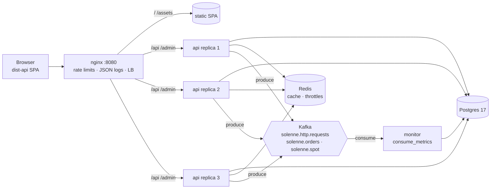

# Backend (self-hosted build)

The self-hosted build replaces the Artifact DB with a Django/DRF API behind nginx, with Kafka carrying monitoring
events. The claude.ai Artifact build does not use any of this (its host blocks requests to other origins); see
[ADR-0004](adr/0004-self-hosted-django-backend.md).



## Layout (`backend/`)
| Path | Responsibility |
|---|---|
| `solenne/settings.py` | Env-driven settings (`DATABASE_URL`, `REDIS_URL`, `KAFKA_*`, `DJANGO_*`, `THROTTLE_*`). |
| `solenne/urls.py` | `/api/v1/*` routes, `/admin/`, JSON 404/500. |
| `solenne/middleware.py`, `logging.py` | `X-Request-ID` correlation, `X-Served-By` (replica host), JSON log lines. |
| `solenne/errors.py` | `ApiError` and the error envelope. |
| `solenne/auth.py`, `permissions.py` | Owner JWT sign-in/refresh/logout/me; `IsOwner` = active staff user. |
| `catalog/` | `Product` (mirror of `src/domain/products.ts`), `SpotPrice` history, `pricing.py` (port of `pricing.ts`), spot cache, `seed_catalog`, `ensure_owner`. |
| `orders/` | `Order` + `OrderLine`, server-side re-pricing and idempotent placement (`services.py`), owner list/detail. |
| `monitoring/` | Kafka producer (`events.py`), request metrics middleware, consumer rollups, `/monitor/stats/`. |
| `tests/` | pytest-django: pricing parity, orders, auth, throttles, monitoring. |

The catalogue has one source of truth, `src/domain`. `npm run export:catalog` writes
`backend/catalog/fixtures/catalog.json` and `price_golden.json`; run it after changing products or pricing, and
`tests/test_pricing.py` fails until `catalog/pricing.py` agrees with the browser on every case.

## API (`/api/v1/`)
All bodies are JSON in the same camelCase shapes as `src/services/orders.ts`. Errors are always
`{"error": "<code>", "detail": "<message>", ...}`.

| Method & path | Who | Notes |
|---|---|---|
| `GET health/` | public | `{status, db, cache, instance}`; 503 when Postgres is down. |
| `GET spot/` | public | `{perGram, asOf}`. `ETag` + `Cache-Control: public, max-age=30`; `If-None-Match` → 304. Cached in Redis. |
| `PUT spot/` | owner | `{perGram: 20–2000, asOf: "YYYY-MM-DD"}`. Appends to history, clears the cache, emits `spot.updated`. |
| `POST orders/` | public | Body `{customer, delivery, lines: [{slug, config, qty}], total}`; header `Idempotency-Key: SLN-XXXXXX`. See below. |
| `GET orders/` | owner | Cursor pages `{next, previous, results}`, newest first, `?limit=` (≤200), `?status=`. Lines are prefetched (3 queries per page). |
| `GET orders/<code>/` | owner | One order. |
| `PATCH orders/<code>/` | owner | `{status}`; received → confirmed/cancelled → shipped. Other moves: 409 `bad-transition`. |
| `POST auth/token/` | public | `{email, password}` → `{access, user}` + refresh cookie. |
| `POST auth/refresh/` | cookie | Needs `X-Requested-With: fetch`. Rotates the refresh token (single use). |
| `POST auth/logout/` | cookie | Blacklists the refresh token, clears the cookie. |
| `GET auth/me/` | any | `{authenticated, isOwner, email}`. |
| `GET monitor/stats/?minutes=60` | owner | Requests/min, error rates, avg/max latency, top routes, per-minute timeline, orders and revenue. |

### Placing an order
1. Validates customer fields (same rules as the checkout form) and every line against the catalogue: allowed
   colour/karat (24k is yellow only), variant, size, finish, engraving length.
2. Re-prices every line at the server's spot with `catalog/pricing.py` (one query for all products).
3. If the client's `total` differs by more than $1: **409 `price-changed`** with `{spot, quote}`. The page updates
   its spot and shows the new total; nothing is stored.
4. Stores the order and its lines in one transaction. The `Idempotency-Key` (the page's order code) makes retries
   safe: the same key with the same payload returns the stored order (200), with a different payload 409
   `code-in-use`.
5. After commit, emits `order.created` to Kafka.

### Owner session
The access token (10 min) is returned in the body and kept in memory only. The refresh token (7 days, rotated,
blacklisted after use) is an `httpOnly; SameSite=Strict` cookie limited to `/api/v1/auth/`. The page only tries a
silent refresh when `localStorage['solenne.ownerSession']` says an owner signed in on this browser, so ordinary
visitors never call the auth endpoints. Create the owner with `OWNER_EMAIL`/`OWNER_PASSWORD` (the `migrate` job
runs `manage.py ensure_owner`). The same account signs in to `/admin/`.

### Throttling (two layers)
| Layer | Scope | Limit |
|---|---|---|
| nginx `limit_req` | any path, per IP | 20 r/s, burst 40 |
| nginx | `POST /api/v1/orders/` (owner GETs are exempt) | 5 r/min, burst 3 |
| nginx | `/api/v1/auth/`, `/admin/` | 10 r/min, burst 5 / 20 |
| nginx `limit_conn` | per IP | 20 connections |
| DRF (Redis, shared by replicas) | anonymous API calls | 120/min (`THROTTLE_ANON`) |
| DRF | order placement | 10/hour per IP (`THROTTLE_ORDERS`) |
| DRF | sign-in / refresh | 10/min (`THROTTLE_AUTH`) |

nginx refusals answer `429 {"error":"throttled",...}` from `infra/nginx/errors/`; DRF's carry an exact `retryAfter`.

## Kafka monitoring
| Topic | Event | Fields |
|---|---|---|
| `solenne.http.requests` | `http.request` (every `/api/` call except health) | `ts, requestId, instance, method, route` (URL pattern, e.g. `/api/v1/orders/<str:code>/`), `status, durationMs` |
| `solenne.orders` | `order.created` | `ts, requestId, instance, code, total, lineCount, delivery` |
| `solenne.spot` | `spot.updated` | `ts, requestId, instance, perGram, asOf` |

- The producer (`monitoring/events.py`) only enqueues into librdkafka's buffer (`linger.ms` 50, lz4). If Kafka is
  down or the buffer is full the event is dropped and a warning is logged at most once a minute; requests never
  wait on Kafka. `KAFKA_ENABLED=false` (tests, local dev) records events in memory instead.
- The `migrate` job runs `manage.py ensure_topics` (3 partitions, 72 h retention) so the topics exist before the
  consumer subscribes.
- `manage.py consume_metrics` (the `monitor` service, group `solenne-monitor`) polls batches of up to 500, folds
  them into per-minute `MetricBucket` rows (one upsert per minute/method/route) and `OrderEvent` rows, then commits
  offsets: at-least-once.
- `requestId` is nginx's `$request_id`, so an event, the nginx access line and the Django log line for one request
  share an id.
- Browse topics with Kafka UI: `docker compose --profile tools up -d kafka-ui` → http://localhost:8081.

## nginx (`infra/nginx/`)
- Serves `dist-api/` (built inside the image by `npm run build:api`): hashed `/assets/` cached for a year
  (`immutable`), `index.html` `no-cache`, SPA fallback to `index.html`.
- `upstream api` with `least_conn`, `keepalive 32`, passive health checks (`max_fails=3 fail_timeout=10s`) and
  `resolve` through Docker DNS, so every `api` replica gets traffic and scaling needs no nginx change. Connection
  errors and 502/503 fail over to another replica; nginx never replays POST/PUT/PATCH.
- Limits: 64 KB bodies on `/api/` (4 KB on auth, 1 MB elsewhere), 10 s client body/header timeouts, 5 s connect
  and 30 s read timeouts upstream, gzip for JSON/JS/CSS.
- Logs: one JSON object per line on stdout and in the `nginx-logs` volume (`access.json.log`) with `request_id`,
  `upstream_addr`, `upstream_response_time`, `limit_req` status. Security headers and a CSP that allows only
  this origin plus Google Fonts.

## Running
```bash
cp .env.example .env               # set DJANGO_SECRET_KEY, POSTGRES_PASSWORD, OWNER_EMAIL, OWNER_PASSWORD
docker compose up -d --build       # http://localhost:8080 · admin at /admin/
docker compose logs -f nginx monitor
docker build --target dev -t solenne-api-test backend && docker run --rm solenne-api-test   # pytest
```
Without Docker: `cd backend && pip install -r requirements-dev.txt && python manage.py migrate && python manage.py
seed_catalog && python manage.py runserver` (SQLite, Kafka off), then `npm run dev:api` (Vite proxies `/api`).
